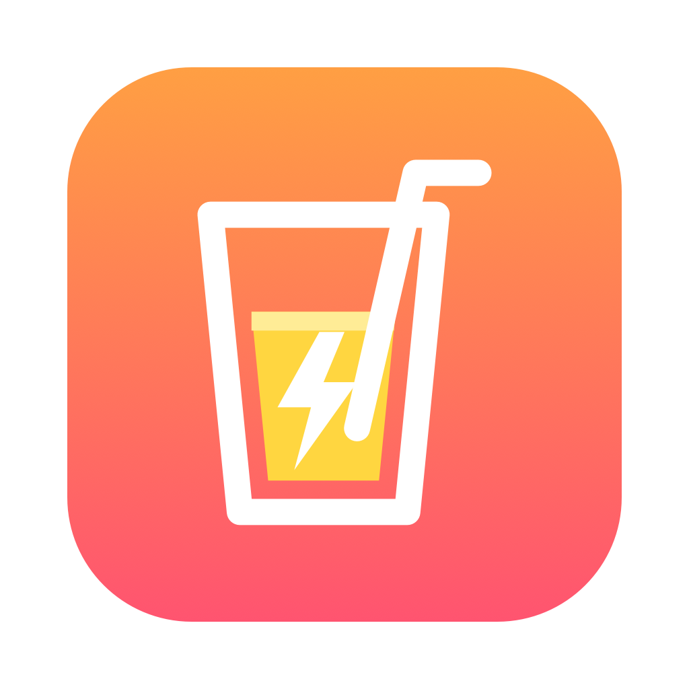

<p align="center"></p>

# Juice Bar

Battery % of your wireless mouse and keyboard, in the Mac menu bar and the Windows tray. Works over
2.4 GHz dongles, where the OS shows nothing, and over Bluetooth. Free and open source (GPL-3.0).

- **One glance:** a juice glass in the menu bar fills to your lowest device. Green when everything
  is above 85%, plain from 30 to 85%, amber from 20 to 30%, red below 20%.
- **One click:** every device with its real name and %, a bolt when charging; hover a row for its
  connection (2.4 GHz, Bluetooth, USB). Right click for Settings and Quit.
- **Native and light:** AppKit on Mac, Fluent on Windows; follows light/dark, accent and contrast.
  0.0% CPU at idle, about 14 MB of memory on the Mac.

## Supported devices

| # | Device | Connection | Status |
|---|---|---|---|
| 1 | Kreo Swarm 75 (dongle 3554:fa09) | 2.4 GHz | Reads %, verified |
| 2 | Kreo Hawk Pro family, incl. Amkette XS Flow Pro Plus (dongle 04f3:026f) | 2.4 GHz | Reads %, verified |
| 3 | Any mouse or keyboard macOS / Windows reports over Bluetooth | Bluetooth | Reads % from the OS |

Not listed? Right click (or ⌥-click) the device in the menu, then **Report**. It opens a prefilled GitHub issue
with only the device's ids and its USB product name (never your rename), which you see before
sending, so support can be added. **Try to detect** sends the battery read command of every known
protocol to the device, only when you click it, and asks you once before the first time.

## Install

Download from Releases: `JuiceBar-mac-arm64.zip` (Apple Silicon), `JuiceBar-x64.exe`,
`JuiceBar-arm64.exe`. On Mac, macOS may ask for **Input Monitoring**: some dongles (the Hawk Pro
family) only answer once it is allowed.

## Updates

Juice Bar checks GitHub for a new release, daily by default (Settings, **Check for updates**: on
launch, daily, weekly, monthly or never). A new version is installed only when the release's
checksums carry the project's signature, and only after you click **Install** when it asks; **Later**
asks again at the next check. No need to download and replace the app by hand.

## Privacy

The update check is the only time Juice Bar goes online. It sends only the app's name as the
User-Agent; GitHub sees your IP address, as with any download. Set **Check for updates** to
**Never** and Juice Bar makes no internet connections at all. Nothing else leaves your computer:
battery readings, device names and settings stay on it. **Report** only opens a page in your browser.

## Build

```sh
cargo test -p juicebar-shared       # protocols replay recorded device answers, no hardware needed
./mac/bundle.sh                     # target/mac/JuiceBar.app, signed with MAC_SIGN_IDENTITY when present
cargo build --release -p juicebar-windows
JUICEBAR_DEMO=1 cargo run -p juicebar-mac --bin JuiceBar   # sample devices, for UI work (debug builds only)
```

Layout: `shared/` holds devices, protocols, names, colours and settings; `mac/` and `windows/` only
draw, with the same file and function names on both sides (`docs/CONTRACT.md`). Protocol notes in
`docs/PROTOCOLS.md`.

## Credits

Protocol layouts learned from Kreo Kontrol's web app and from open source battery tools such as
BatteryBar, BatteryTray, Wireless Device Battery Monitor and mouse_tray. Code here is our own.
