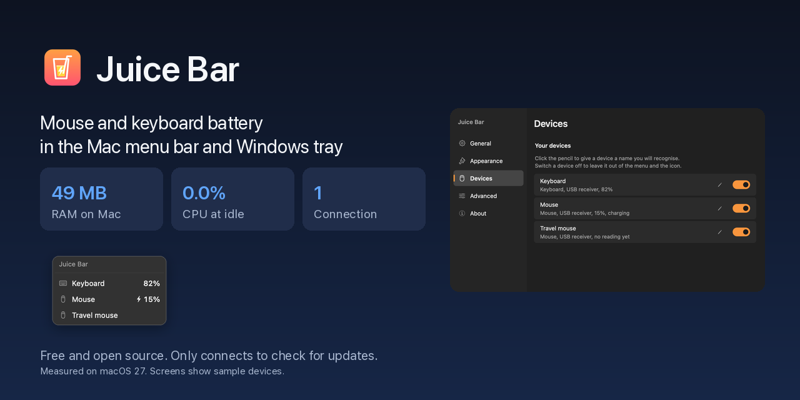
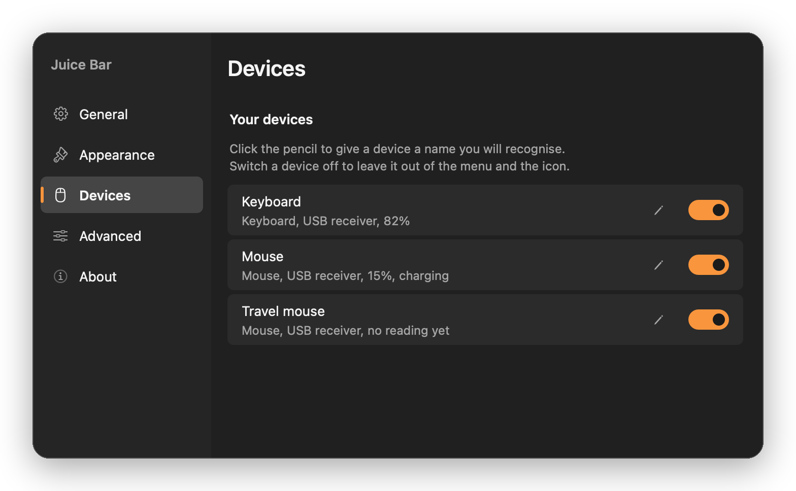
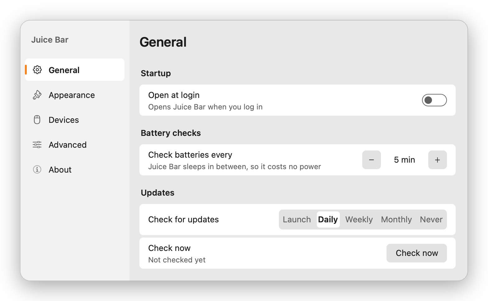

<h1 align="center">Juice Bar (Mouse and Keyboard Battery)</h1>

<p align="center">
  
</p>

<p align="center">
  Battery % of your wireless mouse and keyboard, in the Mac menu bar and the Windows tray. Even over 2.4 GHz dongles, where your computer shows nothing.
</p>

<p align="center">
  <a href="https://github.com/developedByAshu/juice-bar/releases/latest"></a>
</p>

<p align="center">
  
  
  
  
</p>

<table align="center">
  <tr>
    <td align="center" width="170"><h3>1 Glance</h3>The glass fills to your lowest battery</td>
    <td align="center" width="170"><h3>0.0%</h3>CPU at idle</td>
    <td align="center" width="170"><h3>49 MB</h3>RAM on Mac</td>
    <td align="center" width="170"><h3>1</h3>Connection, to GitHub for updates</td>
  </tr>
</table>

## Why I built it

Most wireless mice and keyboards on a 2.4 GHz dongle never tell your computer their battery. You find out when they stop working.

Juice Bar asks the devices directly and puts the answer where you already look.

## Screenshots

<table>
  <tr>
    <td width="50%" align="center"><br><sub>Click the icon for every battery</sub></td>
    <td width="50%" align="center"><br><sub>Hover for a quick look, with how each device is connected</sub></td>
  </tr>
  <tr>
    <td width="50%" align="center"><br><sub>Rename a device, or leave it out (sample devices)</sub></td>
    <td width="50%" align="center"><br><sub>Light, dark or same as your system</sub></td>
  </tr>
</table>

## What it does

<table>
  <tr>
    <td valign="top" width="33%">
      <b>Battery</b>
      <ul>
        <li>2.4 GHz dongles, Bluetooth and USB</li>
        <li>Mice and keyboards</li>
        <li>A bolt when charging</li>
        <li>Hover a row to see how it is connected</li>
      </ul>
    </td>
    <td valign="top" width="33%">
      <b>Colour by lowest battery</b>
      <ul>
        <li> Green above 85%</li>
        <li> Plain from 30 to 85%</li>
        <li> Amber from 20 to 30%</li>
        <li> Red below 20%</li>
      </ul>
    </td>
    <td valign="top" width="33%">
      <b>Feels native</b>
      <ul>
        <li>AppKit on Mac, Fluent on Windows</li>
        <li>Light, dark or same as your system</li>
        <li>Optional % next to the icon</li>
        <li>Rename or hide any device</li>
      </ul>
    </td>
  </tr>
</table>

## Install

Takes about a minute.

**Mac** (Apple silicon)

1. Download [`JuiceBar-mac-arm64.zip`](https://github.com/developedByAshu/juice-bar/releases/latest) and open it.
2. Drag **Juice Bar** to **Applications**, then open it.
3. Blocked the first time? Open **System Settings**, **Privacy & Security**, then **Open Anyway**.
4. Asked for **Input Monitoring**? Allow it. Some dongles only answer once it is on.

**Windows**

1. Download [`JuiceBar-x64.exe`](https://github.com/developedByAshu/juice-bar/releases/latest) (`JuiceBar-arm64.exe` on an ARM PC).
2. Run it.
3. SmartScreen warning? Choose **More info**, then **Run anyway**.

Updates install themselves: the app asks you first and checks our signature.

<details>
<summary><b>Update checks and where to keep the app</b></summary>
<br>

- Juice Bar checks for updates daily by default. Choose launch, daily, weekly, monthly or **Never** in Settings.
- An update installs only if it carries the project's signature, and only after you click **Install**.
- Keep the Windows file in a folder you will keep, since it runs from there.

</details>

<details>
<summary><b>Check your download (optional)</b></summary>
<br>

The app checks every update itself. This checks your first download by hand. You need OpenSSL 3 (`brew install openssl` on Mac, included in Git for Windows). Run it in the folder with your download, with `TAG` set to its release:

```sh
TAG=v0.2.2
curl -sSLO https://github.com/developedByAshu/juice-bar/releases/download/$TAG/SHA256SUMS.txt
curl -sSL https://raw.githubusercontent.com/developedByAshu/juice-bar/main/signatures/$TAG.sig | xxd -r -p > SHA256SUMS.sig
printf -- '-----BEGIN PUBLIC KEY-----\nMCowBQYDK2VwAyEAu9CJdb1tJuzDO+ANYtPdD2j5jYhW5+hEeJb6i8ltAqQ=\n-----END PUBLIC KEY-----\n' > release-key.pem
OPENSSL=$(brew --prefix openssl 2>/dev/null)/bin/openssl; [ -x "$OPENSSL" ] || OPENSSL=openssl
$OPENSSL pkeyutl -verify -pubin -inkey release-key.pem -rawin -in SHA256SUMS.txt -sigfile SHA256SUMS.sig
tr -d '\r' < SHA256SUMS.txt | shasum -a 256 -c --ignore-missing
```

Both must pass: `Signature Verified Successfully`, then `OK` beside your file. If either fails, do not open the file and please [open an issue](https://github.com/developedByAshu/juice-bar/issues).

</details>

<details>
<summary><b>Works on</b></summary>
<br>

Tested on macOS 27 with Apple silicon and on Windows 11. There is no version for Intel Macs. If something breaks, [open an issue](https://github.com/developedByAshu/juice-bar/issues).

</details>

<details>
<summary><b>Privacy</b></summary>
<br>

- The update check is the only time Juice Bar goes online. Set it to **Never** and it makes no connections at all.
- That check sends only the app's name. GitHub sees your IP address, as any website does.
- Battery readings, device names and settings stay on your computer. No account, tracking, ads or server.
- The code is all here, so you can check it yourself.

</details>

## Common questions

<details>
<summary><b>Which devices work?</b></summary>
<br>Any mouse or keyboard your computer already reports over Bluetooth, plus a growing list of 2.4 GHz dongle families that Juice Bar reads directly. If yours shows no %, see the next question.
</details>

<details>
<summary><b>My device shows no %. What now?</b></summary>
<br>Right click (or Option click) it in the menu. <b>Try to detect</b> asks the device for its battery with every protocol Juice Bar knows, only when you click it, and asks you once first. <b>Report</b> opens a prefilled GitHub issue with only the device's ids and its USB product name (never your rename), which you see before sending.
</details>

<details>
<summary><b>Does it drain my mouse or keyboard?</b></summary>
<br>No. It checks every few minutes (5 by default, set in Settings) and sleeps in between.
</details>

<details>
<summary><b>How do I remove it?</b></summary>
<br>Turn off <b>Open at login</b> on Mac or <b>Start with Windows</b> on Windows, quit it, then delete the app and its settings folder: <code>~/Library/Application Support/JuiceBar</code> on Mac, <code>%APPDATA%\JuiceBar</code> on Windows.
</details>

<details>
<summary><b>Build it yourself</b></summary>
<br>

You need Rust, plus the Xcode command line tools on Mac or the Visual Studio C++ build tools on Windows.

```sh
cargo test -p juicebar-shared              # replays recorded device answers, no hardware needed
./mac/bundle.sh                            # builds target/mac/JuiceBar.app
cargo build --release -p juicebar-windows  # builds target\release\JuiceBar.exe
JUICEBAR_DEMO=1 cargo run -p juicebar-mac --bin JuiceBar   # sample devices, debug builds only
```

`shared/` holds devices, protocols, names, colours and settings. `mac/` and `windows/` only draw, with the same file and function names on both sides (`docs/CONTRACT.md`).

</details>

## Licence

[GPL-3.0](LICENSE). Ideas from open source battery tools such as BatteryBar, BatteryTray, Wireless Device Battery Monitor and mouse_tray; the code here is our own.

<!-- README reviewed 29 Nov 2026 -->
