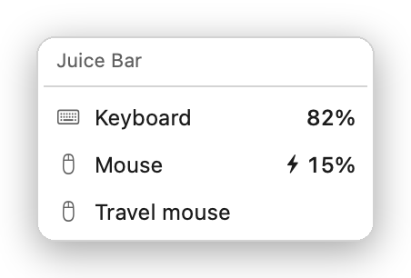
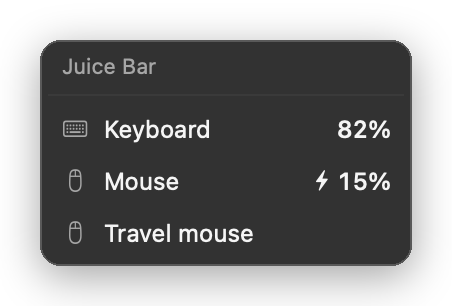

<p align="center">
  
</p>

<h1 align="center">Juice Bar</h1>

<p align="center">
  Battery % of your wireless mouse and keyboard, in the Mac menu bar and the Windows tray.<br>
  Even over 2.4 GHz dongles, where your computer shows nothing.
</p>

<p align="center">
  <a href="https://github.com/developedByAshu/juice-bar/releases/latest"></a>
</p>

<p align="center">
  
  
  
  
</p>

<p align="center">
  
  &nbsp;&nbsp;
  
</p>

<table align="center">
  <tr>
    <td align="center" width="170"><h3>1 glance</h3>the glass fills to your lowest battery</td>
    <td align="center" width="170"><h3>0.0%</h3>CPU at idle</td>
    <td align="center" width="170"><h3>~14 MB</h3>RAM on Mac</td>
    <td align="center" width="170"><h3>1</h3>connection, to GitHub for updates</td>
  </tr>
</table>

## Why

Most wireless mice and keyboards on a 2.4 GHz dongle never tell your computer their battery. You find out when they stop working.

Juice Bar asks the devices directly and puts the answer where you already look.

## Screenshots

<table>
  <tr>
    <td width="50%" align="center"><br><sub>Hover the icon for every battery at once</sub></td>
    <td width="50%" align="center"><br><sub>Rename a device, or leave it out</sub></td>
  </tr>
  <tr>
    <td colspan="2" align="center"><br><sub>Light and dark, same as your system (sample devices)</sub></td>
  </tr>
</table>

## What it does

<table>
  <tr>
    <td valign="top" width="33%">
      <b>Battery</b>
      <ul>
        <li>2.4 GHz dongles, Bluetooth and USB</li>
        <li>Mice and keyboards</li>
        <li>A bolt when charging</li>
        <li>Hover a row to see how it is connected</li>
      </ul>
    </td>
    <td valign="top" width="33%">
      <b>Colour by lowest battery</b>
      <ul>
        <li> Green above 85%</li>
        <li> Plain from 30 to 85%</li>
        <li> Amber from 20 to 30%</li>
        <li> Red below 20%</li>
      </ul>
    </td>
    <td valign="top" width="33%">
      <b>Feels native</b>
      <ul>
        <li>AppKit on Mac, Fluent on Windows</li>
        <li>Light, dark or same as your system</li>
        <li>Optional % next to the icon</li>
        <li>Rename or hide any device</li>
      </ul>
    </td>
  </tr>
</table>

## Install

### Mac (Apple silicon only)

1. Download `JuiceBar-mac-arm64.zip` from [Releases](https://github.com/developedByAshu/juice-bar/releases/latest) and unzip it.
2. Move `JuiceBar` to Applications, then open it.
3. macOS blocks it the first time because the app is not signed by Apple. Open **System Settings**, **Privacy & Security**, choose **Open Anyway**, then open it again.
4. If macOS asks for **Input Monitoring**, allow it. Some dongles only answer once it is on.

### Windows

1. Download `JuiceBar-x64.exe` from [Releases](https://github.com/developedByAshu/juice-bar/releases/latest). On a Windows on ARM PC, take `JuiceBar-arm64.exe`.
2. Put it in a folder you will keep, then run it.
3. Windows may show a SmartScreen warning because the program is not code signed yet. Choose **More info**, then **Run anyway**.

`SHA256SUMS.txt` in each release lets you check the file.

## Updates

Juice Bar checks GitHub daily by default (on launch, daily, weekly, monthly or **Never**, in Settings). It installs a new version only when the release carries the project's signature, and only after you click **Install**. No need to replace the app by hand.

## Privacy

- The update check is the only time Juice Bar goes online. Set it to **Never** and it makes no connections at all.
- That check sends only the app's name. GitHub sees your IP address, as any website does.
- Battery readings, device names and settings stay on your computer. No account, tracking, ads or server.
- The code is all here, so you can check it yourself.

## Common questions

<details>
<summary><b>Which devices work?</b></summary>
<br>Any mouse or keyboard your computer already reports over Bluetooth, plus a growing list of 2.4 GHz dongle families that Juice Bar reads directly. If yours shows no %, see the next question.
</details>

<details>
<summary><b>My device shows no %. What now?</b></summary>
<br>Right click (or Option click) it in the menu. <b>Try to detect</b> asks the device for its battery with every protocol Juice Bar knows, only when you click it, and asks you once first. <b>Report</b> opens a prefilled GitHub issue with only the device's ids and its USB product name (never your rename), which you see before sending.
</details>

<details>
<summary><b>Does it drain my mouse or keyboard?</b></summary>
<br>No. It checks every few minutes (5 by default, set in Settings) and sleeps in between.
</details>

<details>
<summary><b>How do I remove it?</b></summary>
<br>Turn off <b>Open at login</b> on Mac or <b>Start with Windows</b> on Windows, quit it, then delete the app and its settings folder: <code>~/Library/Application Support/JuiceBar</code> on Mac, <code>%APPDATA%\JuiceBar</code> on Windows.
</details>

<details>
<summary><b>Build it yourself</b></summary>
<br>You need Rust, plus the Xcode command line tools on Mac or the Visual Studio C++ build tools on Windows.

```sh
cargo test -p juicebar-shared              # replays recorded device answers, no hardware needed
./mac/bundle.sh                            # builds target/mac/JuiceBar.app
cargo build --release -p juicebar-windows  # builds target\release\JuiceBar.exe
JUICEBAR_DEMO=1 cargo run -p juicebar-mac --bin JuiceBar   # sample devices, debug builds only
```

`shared/` holds devices, protocols, names, colours and settings. `mac/` and `windows/` only draw, with the same file and function names on both sides (`docs/CONTRACT.md`).
</details>

## Credits

Ideas from open source battery tools such as BatteryBar, BatteryTray, Wireless Device Battery Monitor and mouse_tray. The code here is our own.

## Licence

[GPL-3.0](LICENSE)
